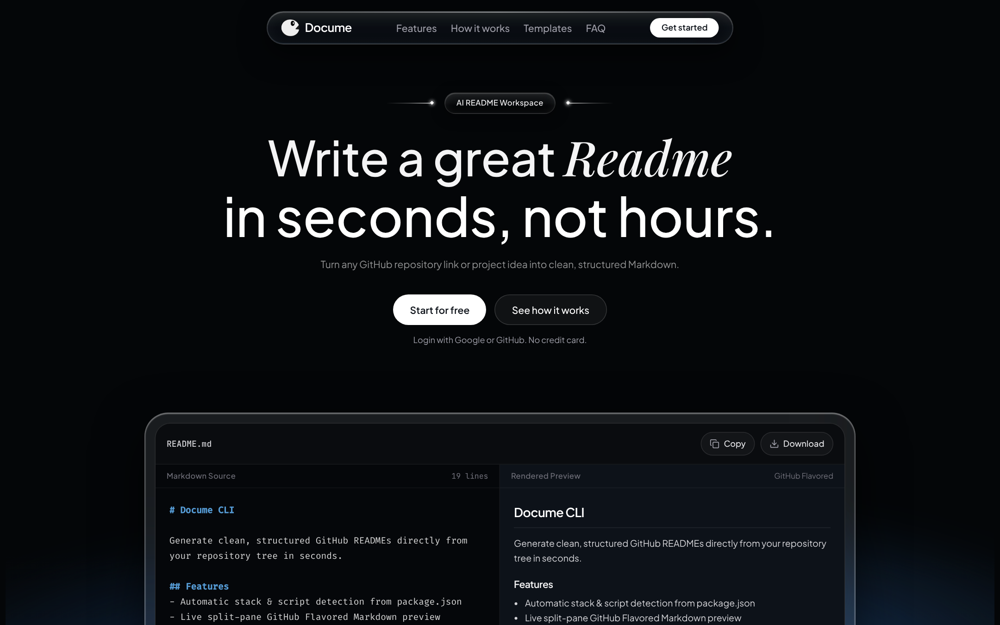
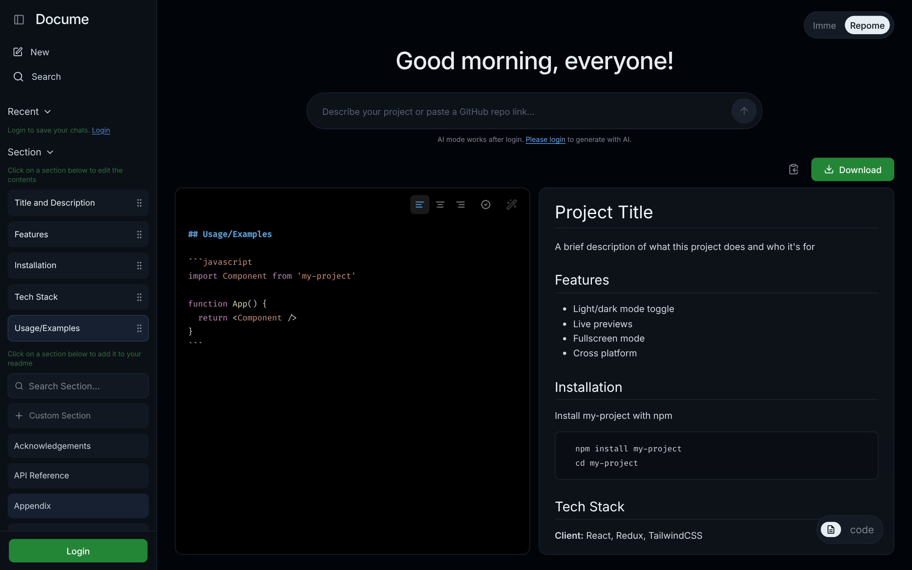
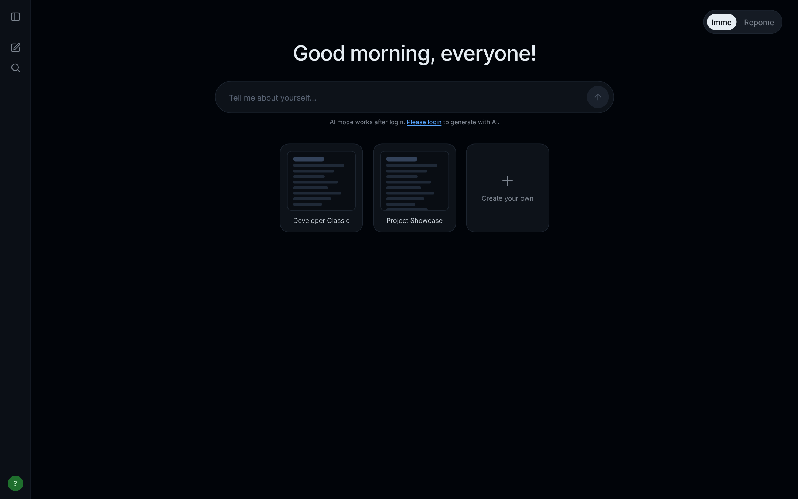
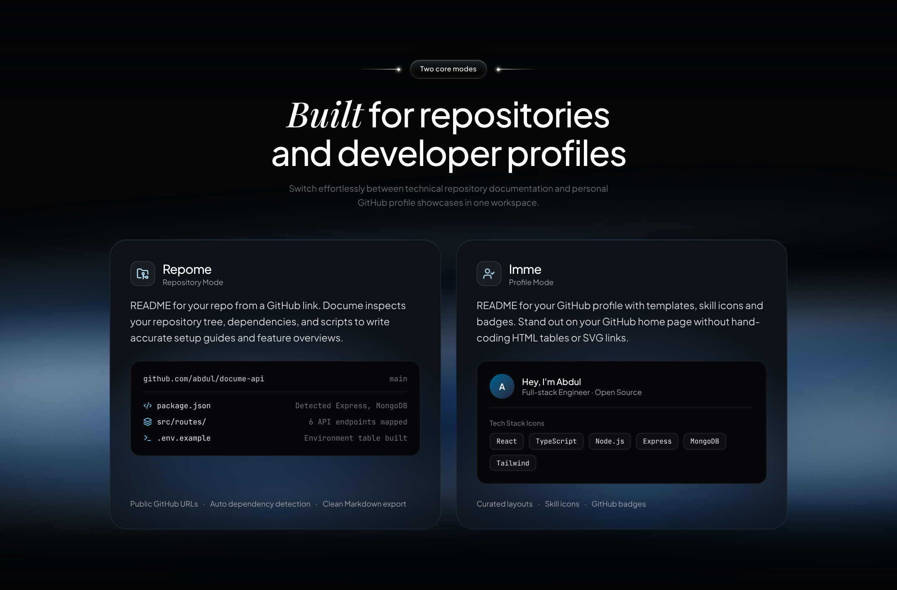
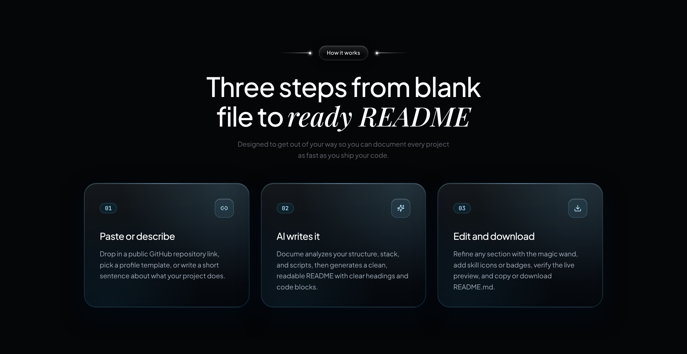
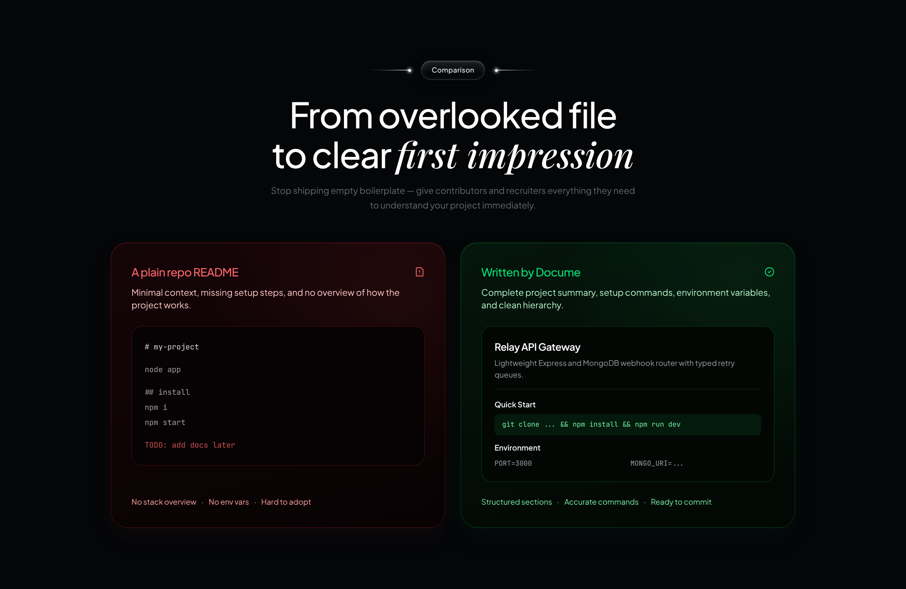
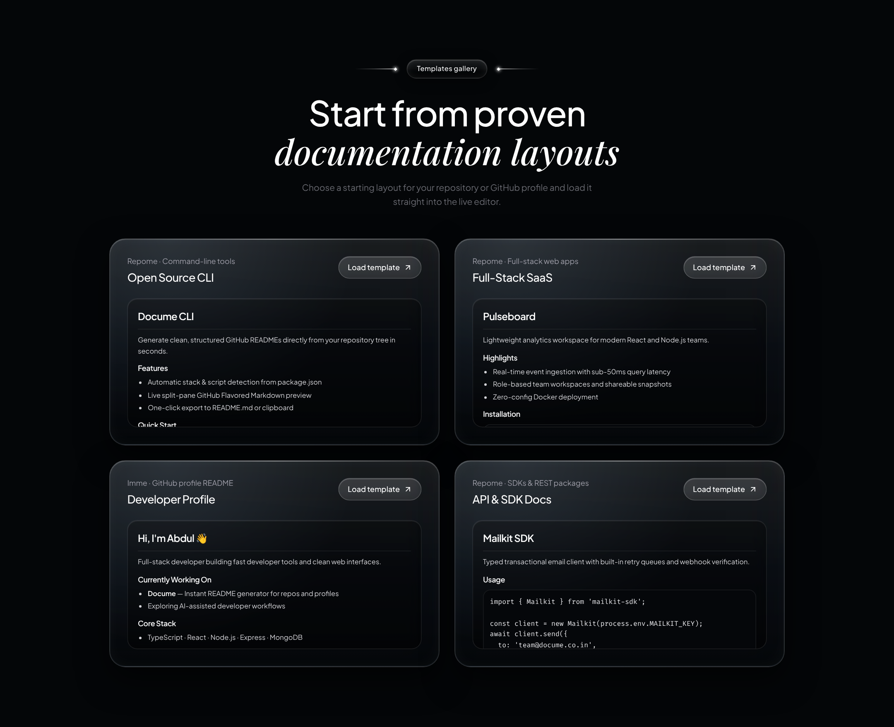
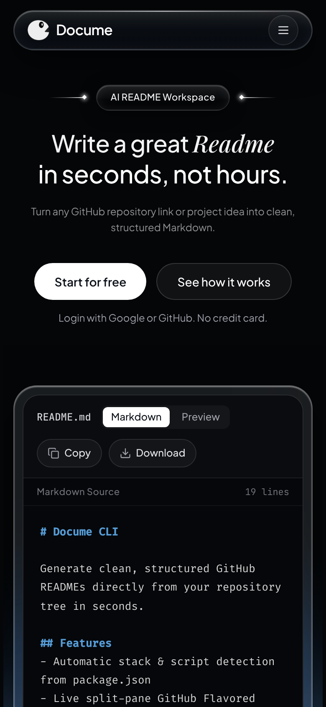
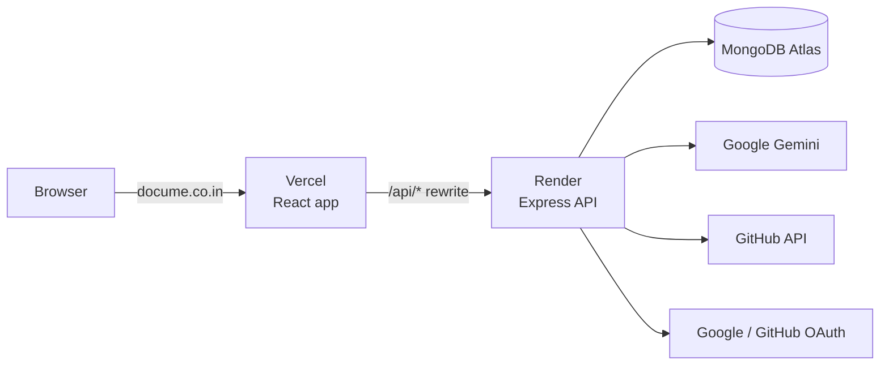

<div align="center">

  
# Docume

**Write a great README in seconds, not hours.**

A free AI README generator for GitHub repositories and profiles.
Paste a repo link or describe your project, edit it live, and download a clean `README.md`.

[**Live site → docume.co.in**](https://docume.co.in)


</div>

---

## Overview

Docume turns a GitHub repository link (or a short project description) into a structured, professional README. It has two modes:

| Mode | What it does |
| :--- | :--- |
| **Repome** | README for a repository. Reads public repo info from GitHub and writes title, features, tech stack, install and usage sections. |
| **Imme** | README for your GitHub profile. Pick a template, then add skill icons and badges. |

Everything is edited in a split view: a VS Code style Markdown editor on the left and a live GitHub-style preview on the right.

## Screenshots

<div align="center">

**Landing page**



**Editor (Repome): pick sections, edit Markdown, see the live preview**



**Imme: GitHub profile README templates**



| Two modes | How it works |
| :---: | :---: |
|  |  |

| Before and after | Templates |
| :---: | :---: |
|  |  |

**Mobile**



</div>

## Features

- **AI generation** with Google Gemini from a repo link or a plain description
- **Magic wand** to rewrite or improve any single section
- **Section based editor** with drag and drop ordering, 20+ ready sections and custom sections
- **Live preview** with GitHub Flavored Markdown (tables, task lists, code blocks)
- **Skill icons and badges picker** for profile READMEs
- **Imme templates** for GitHub profile READMEs
- **Saved chats** with debounced autosave and delete
- **Login with Google or GitHub** (OAuth, no passwords)
- **Fair usage limits** per user and per site, shown in the UI with a reset timer
- **Copy and download** as `README.md`
- **Landing page, Privacy Policy and Terms** at `/`, `/privacy`, `/terms`
- **Resilience**: error boundary, offline retry, unsaved changes warning

## Tech Stack

| Layer | Technologies |
| :--- | :--- |
| Frontend | React 18, Vite 5, Tailwind CSS v4, lucide-react, dnd-kit, react-markdown, remark-gfm, rehype-raw, rehype-sanitize, Prism, react-simple-code-editor |
| Backend | Node.js, Express, Mongoose, Passport (Google and GitHub OAuth), JWT (httpOnly cookie), Helmet, express-rate-limit |
| Database | MongoDB Atlas |
| AI | Google Gemini (with retry and fallback model) |
| Hosting | Vercel (client), Render (server), MongoDB Atlas, UptimeRobot (keep-alive) |
| Testing | Node.js built-in test runner (`node:test`) |

## Architecture



The browser only talks to one domain. Vercel rewrites `/api/*` to the Render server, so the login cookie stays first-party (`SameSite=Lax`).

## Project Structure

```
docume/
├── client/                 # React + Vite frontend
│   ├── public/             # favicon, robots.txt, sitemap.xml
│   └── src/
│       ├── App.jsx         # editor app (/app)
│       ├── main.jsx        # tiny router: /, /app, /privacy, /terms
│       ├── api.js          # API client + friendly error messages
│       ├── components/     # Editor, Preview, Sidebar, PromptBox, ...
│       ├── data/           # sections, templates, icons, badges
│       ├── landing/        # landing page, Privacy and Terms pages
│       └── utils/
└── server/                 # Express API
    ├── src/
    │   ├── routes/         # auth, chats, ai, health
    │   ├── models/         # User, Chat, Usage, SiteUsage
    │   ├── services/       # Gemini, README AI, usage limits
    │   ├── middleware/
    │   └── config/
    └── tests/              # node:test suite
```

## Getting Started

### Prerequisites

- Node.js 18 or newer
- A MongoDB Atlas database (free tier works)
- Google and GitHub OAuth apps (for login)
- A Gemini API key from [Google AI Studio](https://aistudio.google.com)

### 1. Clone

```bash
git clone <your-repo-url>
cd docume
```

### 2. Server

```bash
cd server
npm install
cp .env.example .env     # then fill in the values (see below)
npm run dev              # http://localhost:5000
```

### 3. Client

```bash
cd client
npm install
npm run dev              # http://localhost:5173
```

Vite proxies `/api` to `http://localhost:5000`, so no extra CORS setup is needed in development.

### OAuth callback URLs (development)

- Google: `http://localhost:5000/api/auth/google/callback`
- GitHub: `http://localhost:5000/api/auth/github/callback`

## Environment Variables (server)

Copy `server/.env.example` to `server/.env`. Never commit `.env`.

| Variable | Required | Description |
| :--- | :---: | :--- |
| `MONGODB_URI` | Yes | MongoDB Atlas connection string |
| `JWT_SECRET` | Yes | Secret for the login cookie (32+ characters) |
| `CLIENT_URL` | Yes | Frontend URL (CORS and login redirect). Comma separated for several |
| `SERVER_URL` | Yes | Public URL of the server (builds OAuth callbacks) |
| `GOOGLE_CLIENT_ID` / `GOOGLE_CLIENT_SECRET` | Yes | Google OAuth |
| `GITHUB_CLIENT_ID` / `GITHUB_CLIENT_SECRET` | Yes | GitHub OAuth |
| `GEMINI_API_KEY` | Yes | Gemini API key |
| `GEMINI_MODEL` | No | Model name (default `gemini-flash-latest`) |
| `GEMINI_FALLBACK_MODEL` | No | Used on the last retry when Gemini is busy |
| `GEMINI_WAND_API_KEY` | No | Separate key for the magic wand (use another Google project) |
| `GITHUB_TOKEN` | No | Token without scopes, avoids GitHub's 60 requests per hour limit |
| `AI_TIMEOUT_MS` | No | AI timeout in ms (default 45000) |
| `LIMIT_WINDOW_HOURS` | No | Per-user window (default 5) |
| `LIMIT_GENERATE` / `LIMIT_WAND` | No | Per-user calls per window (default 6 / 15) |
| `SITE_DAILY_GENERATE` / `SITE_DAILY_WAND` | No | Whole-site daily caps |
| `TRUST_PROXY` | Prod | Number of proxies in front of the server (`2` for Vercel + Render) |

## Usage Limits

To keep the free service available for everyone:

- **Per user:** 6 AI generations and 15 magic wand edits in every 5-hour window
- **Whole site:** daily caps kept below the Gemini free-tier limit
- Counters are atomic in MongoDB and failed AI calls are refunded
- The UI shows remaining calls and the reset time

## Testing

```bash
cd server
npm test
```

The suite covers auth, chats, AI limits and the app setup, using in-memory fakes for the database and Gemini (no real keys or network needed).

## Deployment

| Part | Platform | Notes |
| :--- | :--- | :--- |
| Client | Vercel | Root directory `client`. `vercel.json` rewrites `/api/*` to the server and falls back to `index.html` for routes |
| Server | Render | Root directory `server`, start command `npm start`, set `NODE_ENV=production` and `TRUST_PROXY=2` |
| Database | MongoDB Atlas | Allow the Render IP access |
| Keep-alive | UptimeRobot | Pings `/api/health` every 5 minutes so the free server stays awake |

Set the OAuth callback URLs to `https://<your-domain>/api/auth/google/callback` and `/api/auth/github/callback`.

## Security

- Login cookie is `httpOnly` and `SameSite=Lax`, with an OAuth `state` check
- CORS allowlist, Helmet headers and rate limiting
- Markdown preview is sanitized (`rehype-sanitize`)
- Secrets live only in environment variables

## Roadmap

- [ ] Push README to GitHub from the app
- [ ] More Imme and Repome templates
- [ ] Undo and redo in the editor
- [ ] Account export and delete
- [ ] Error monitoring and CI

## License

Licensed under the [GNU AGPL v3.0](LICENSE).

---

<div align="center">

Built with React, Express and Gemini.

</div>
